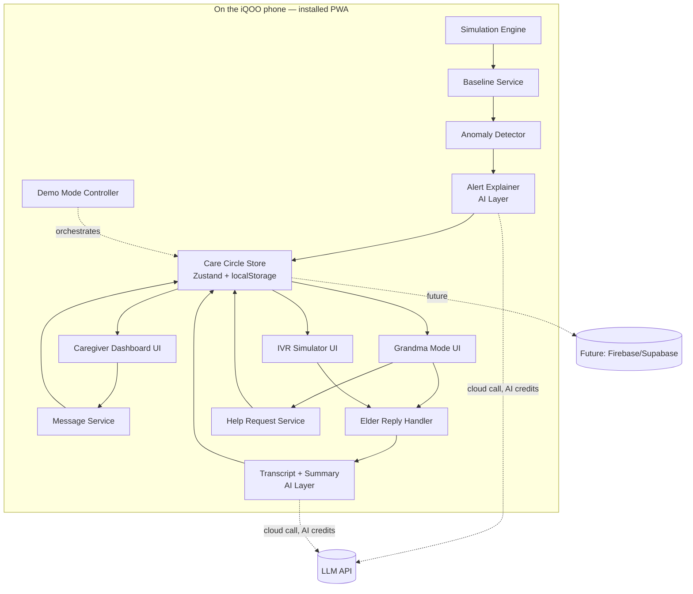
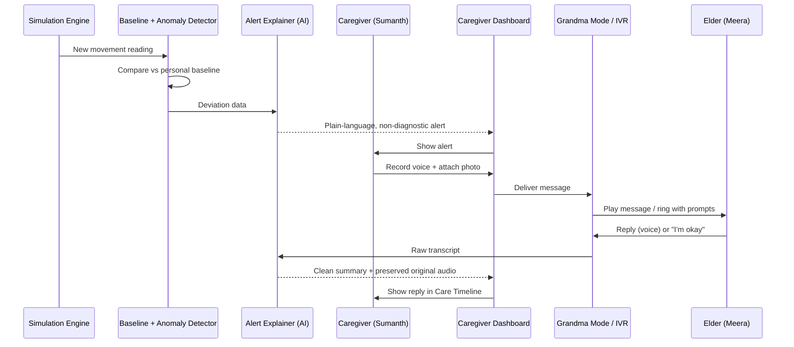
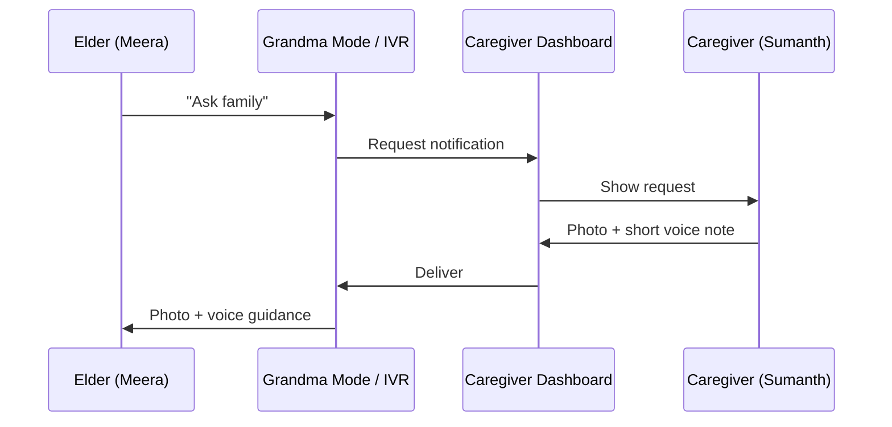
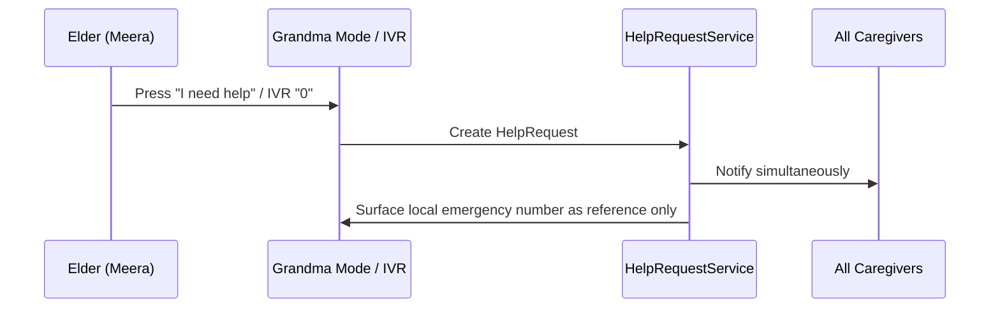

# IQcare — System Architecture

| | |
|---|---|
| **Version** | 1.0 (Hackathon Prototype) |
| **Status** | Draft for iQOO Hackathon 2026 — Hyderabad City Battle |
| **Last updated** | September 22, 2026 |
| **Companion docs** | `prd.md`, `Architecture_essentials.md` |

---

## 1. Purpose & Scope

This document describes how IQcare is actually built for the 30-hour Hyderabad City Battle: the stack, the data model, the module boundaries, the core algorithms, and — because this hackathon scores it directly — how AI is genuinely integrated rather than mentioned in passing. It also carries forward every gap identified in `prd.md` into concrete technical decisions.

---

## 2. Architecture Goals & Principles

1. **Demo-reliability first.** Nothing in the critical demo path may depend on venue Wi-Fi, a second device, or a live microphone with no fallback.
2. **Phone-first, for real.** The primary execution surface is the iQOO phone itself — not a laptop browser resized to look like one. See §3.
3. **Simulate external systems behind real interfaces.** Telephony, wearables, and persistence are mocked *behind the same interface a real integration would use*, so swapping in Twilio, Google Fit, or a real database later is additive, not a rewrite.
4. **Safety is enforced in code, not just in copy.** All alert language passes through one function. It is structurally impossible for a diagnostic claim to reach the caregiver screen from anywhere else in the codebase.
5. **Explainability over sophistication.** The anomaly-detection logic is intentionally simple and inspectable — a black-box model would quietly undermine the "explainable, non-diagnostic" promise this product is built on.
6. **AI does real work.** Per §10, AI is not a bolt-on transcript feature; it is the layer that turns numbers into language and turns a messy voice reply into a clear update.

---

## 3. Hackathon Build Constraints → Architecture Decisions

This section exists because it is the single biggest way this build differs from a "normal" hackathon prototype. Source: iQOO Hackathon 2026 organizer materials and press coverage (see `prd.md` §4).

| Constraint | Architecture response |
|---|---|
| Demo **must run on the iQOO phone**, not just be shown from a laptop | Build as a **mobile-first, installable PWA** (Progressive Web App) — home-screen installable, full-screen, no browser chrome visible during the demo. See §4. |
| **Creative phone use** (camera, voice, on-device AI) is 15% of score, device-tracked | Camera and mic are wired to the **real** MediaDevices/MediaRecorder APIs from the start — never a file picker standing in for the camera. |
| **Office Kit usage** is 10% of score, device-tracked | Plan Red Light work (phone-only) to be real, substantive coding — not cosmetic — so Office Kit time reflects genuine build time. See §12 for the suggested task split. |
| **On-device AI** earns an explicit bonus; cloud-only is penalized in organizer guidance | Two-tier AI layer: a cloud call (using provided AI credits) as the reliable default, with on-device inference as a clearly-scoped stretch goal. See §10. |
| 30 hours total, ~55–60% phone-only | Scope is the `prd.md` §8 MoSCoW list, not the full two-interface, multi-language system described in the original concept doc. |
| Loaner device only available from event check-in | Develop and test against a comparable mid/high-end Android phone beforehand; treat the loaner as a late integration target, not the primary dev device throughout. |

---

## 4. High-Level System Diagram



---

## 5. Tech Stack

| Layer | Choice | Why |
|---|---|---|
| Language | TypeScript | Type-safe data model, fewer demo-day surprises |
| Framework | React 18 + Vite | Fast build, fast dev-server reload — matters inside a 30-hour clock |
| App shell | PWA (Web App Manifest + Service Worker) | Installable on the iQOO phone home screen; satisfies "runs on the phone," not "opens in a browser tab" |
| Styling | Tailwind CSS | Fast to hit accessibility targets (contrast, spacing) consistently across two very different UIs |
| State | Zustand (+ `persist` middleware → localStorage) | Minimal boilerplate; localStorage persistence survives a page refresh mid-demo without needing a backend |
| Charts (optional, dashboard trend view) | Recharts | Small footprint, quick to wire to the Baseline Service's data |
| Icons | lucide-react | Broad icon set, tree-shakeable |
| Camera / mic capture | `getUserMedia` + `MediaRecorder` (Web APIs) | Real device I/O — required for the "creative phone use" scoring criterion |
| Audio playback | HTML5 `<audio>` | No dependency needed |
| Speech-to-text (transcripts) | Web Speech API (`SpeechRecognition`) primary; scripted fallback text for demo safety | Free, on-device on Chrome/Android; unreliable cross-browser, so never the *only* path (§10, §16) |
| Text-to-speech (IVR prompts) | Web Speech API (`SpeechSynthesis`), with pre-recorded audio fallback for the demo language(s) | Same reasoning — live TTS is a nice-to-have, not the reliability path |
| AI / LLM calls | Cloud call using hackathon-provided AI credits (default); on-device inference (e.g. a small quantized model via a browser-side LLM runtime) as a stretch goal | See §10 for the full reasoning and fallback chain |
| Testing | Vitest | Matches Vite; used only for the pure-logic modules (§8) where a bug is easy to miss under time pressure |
| Hosting | Vercel or Netlify | Free, fast, HTTPS by default — **HTTPS is mandatory**, camera/mic access is blocked on plain HTTP (§16) |
| Version control | Git / GitHub | Standard; also where these three docs live |
| *(Optional, future)* Backend | Firebase (Firestore + Realtime) or Supabase | Only if real cross-device sync becomes a stretch goal — not required for the core demo, see §12 |

---

## 6. Application Structure

```
src/
  app/                     # app shell, routing between the three UI modes
  components/
    caregiver/             # dashboard, compose, timeline
    grandma/                # 3(+1)-button smartphone UI
    ivr/                    # on-screen IVR call simulator
    shared/                 # buttons, cards, audio player — shared design system
  state/
    careCircleStore.ts       # single Zustand store — see §12
  services/
    simulation/              # SimulationEngine
    baseline/                 # BaselineService
    anomaly/                  # AnomalyDetector
    alertExplainer/            # AlertExplainer + SafetyGuard (§10)
    message/                   # MessageService
    ivrSimulator/               # IVRSimulator
    transcript/                  # TranscriptService (§10)
    help/                         # HelpRequestService
    consent/                       # ConsentService
    demo/                           # DemoModeController
  data/
    models.ts                # all TypeScript interfaces (§7)
    mockSeed.ts               # scripted demo data
  utils/
```

---

## 7. Data Models

```typescript
// ---- Identity & family structure ----

interface CareCircle {
  id: string;
  elderId: string;               // v1: one elder per circle
  caregiverIds: string[];
  primaryCaregiverId: string;
  preferredLanguages: string[];
  createdAt: string;             // ISO timestamp
}

interface Caregiver {
  id: string;
  name: string;
  phone: string;
  role: 'primary' | 'secondary';
  notifyBy: ('push' | 'sms' | 'email')[];
  careCircleIds: string[];       // supports a caregiver belonging to more than one circle
}

interface ElderProfile {
  id: string;
  name: string;
  photoUrl?: string;
  preferredLanguage: string;     // e.g. 'te-IN', 'hi-IN', 'en-IN'
  deviceType: 'smartphone' | 'keypad';
  phoneNumber: string;           // used by the IVR simulator
  timezone: string;
  careCircleId: string;
  onboardedAt: string;
}

// ---- Consent (closes the PRD §9.10 gap) ----

interface ConsentRecord {
  elderId: string;
  consentGivenAt: string;
  consentGivenBy: 'elder' | 'guardian';
  monitoredMetrics: string[];    // e.g. ['movement', 'sleep']
  visibleTo: string[];           // caregiverIds allowed to see alerts
  revocable: true;               // always true, not configurable
  lastReviewedAt: string;
}

// ---- Signals, baseline, alerts ----

interface WearableSignal {
  id: string;
  elderId: string;
  metricType: 'movement' | 'heartRate' | 'sleepHours';
  value: number;
  timestamp: string;
  source: 'simulated' | 'real';
}

interface Baseline {
  elderId: string;
  metricType: string;
  timeOfDayBucket: 'morning' | 'afternoon' | 'evening' | 'night';
  meanValue: number;
  stdDev: number;
  sampleCount: number;           // gates the cold-start rule, §9
  lastUpdated: string;
}

interface Alert {
  id: string;
  elderId: string;
  metricType: string;
  observedValue: number;
  baselineValue: number;
  deviationScore: number;        // simple z-score-like number
  explanationText: string;       // always produced by AlertExplainer — never hand-written inline
  status: 'new' | 'acknowledged' | 'actioned' | 'dismissed' | 'expired';
  createdAt: string;
  cooldownUntil?: string;        // alert-fatigue control, §9
  linkedMessageId?: string;
}

// ---- Messaging loop ----

interface Message {
  id: string;
  careCircleId: string;
  elderId: string;
  fromCaregiverId: string;
  type: 'voice' | 'photo' | 'text';
  mediaRef: string;              // object URL / base64 / storage key
  createdAt: string;
  deliveryChannel: 'grandma-app' | 'ivr';
  status: 'sent' | 'delivered' | 'played' | 'replied';
}

interface ElderReply {
  id: string;
  respondingToMessageId?: string;
  respondingToAlertId?: string;
  elderId: string;
  type: 'voice' | 'quick-status';
  audioRef?: string;
  transcript?: string;
  aiAssisted: true;              // always true when transcript is present — never implied otherwise
  quickStatus?: 'okay' | 'need-help';
  channel: 'grandma-app' | 'ivr';
  createdAt: string;
}

// ---- Emergency path (closes the PRD §9.8 gap) ----

interface HelpRequest {
  id: string;
  elderId: string;
  createdAt: string;
  channel: 'grandma-app' | 'ivr';
  notifiedCaregiverIds: string[];
  status: 'open' | 'seen' | 'resolved';
}

// ---- IVR ----

interface IVRSession {
  id: string;
  elderId: string;
  startedAt: string;
  endedAt?: string;
  promptLanguage: string;
  keyPresses: string[];          // e.g. ['1', '3']
  outcome: 'listened' | 'replied' | 'okay' | 'help-requested' | 'no-answer';
  linkedMessageId?: string;
}

// ---- Shared timeline ----

interface CareTimelineEvent {
  id: string;
  careCircleId: string;
  type: 'alert' | 'message' | 'reply' | 'status' | 'help-request' | 'consent';
  actorId: string;                // caregiverId or elderId
  timestamp: string;
  summary: string;
  relatedIds: string[];
}

// ---- Demo orchestration ----

interface DemoStep {
  id: string;
  label: string;
  durationSeconds: number;
  autoAdvance: boolean;
}
```

---

## 8. Module Breakdown

| Module | Responsibility | Inputs | Outputs | Notes |
|---|---|---|---|---|
| `SimulationEngine` | Generates a believable, seeded stream of wearable signals so the demo is reproducible | seed, elderId | `WearableSignal[]` | Pure function + seeded RNG so every rehearsal behaves identically |
| `BaselineService` | Maintains rolling mean/stddev per elder × metric × time-of-day bucket | `WearableSignal[]` | `Baseline` | Pure logic, unit-tested (§14) |
| `AnomalyDetector` | Decides whether a new reading deviates enough to alert, applies cooldown | `WearableSignal`, `Baseline`, prior `Alert[]` | boolean + `deviationScore` | Pure logic, unit-tested |
| `AlertExplainer` / `SafetyGuard` | The **only** place alert text is generated; enforces the non-diagnostic template via the AI layer | deviation data | `explanationText` | See §10 — this is the safety chokepoint |
| `CareCircleStore` | Single shared client-side state for the whole demo world | all of the above | reactive state | See §12 |
| `MessageService` | Creates/sends voice+photo messages, updates delivery status | recorded media, elderId | `Message` | Routes to Grandma Mode or IVR based on `deviceType` |
| `IVRSimulator` | Simulates the incoming call: prompts, keypad input, recording | `promptLanguage`, keypresses | `IVRSession` | On-screen phone UI; TTS/pre-recorded prompts |
| `TranscriptService` | Wraps STT and the summarization AI call | audio | `transcript`, `aiAssisted: true` | See §10 |
| `HelpRequestService` | Fires on "I need help," notifies every caregiver | elderId, channel | `HelpRequest` | Always all-caregiver, never single-recipient |
| `ConsentService` | Gates whether `AnomalyDetector` runs at all for a given elder | onboarding input | `ConsentRecord` | See §13 — hard boundary, not optional |
| `DemoModeController` | Drives the scripted, judge-safe demo sequence | `DemoStep[]` | UI state transitions | See §12 |
| `PersistenceLayer` | Thin storage adapter (localStorage today) | any entity | persisted state | Swappable for a real backend without touching UI code |

---

## 9. Core Algorithms (kept deliberately simple and explainable)

### 9.1 Baseline computation
Rolling mean and standard deviation per `(elderId, metricType, timeOfDayBucket)`. Requires a minimum sample count (`Baseline.sampleCount`) before it is considered "active" — below that, the UI shows "Still learning Meera's patterns" rather than a false-confidence baseline (closes the cold-start gap from `prd.md` §9.6).

### 9.2 Anomaly detection
A simple deviation score (z-score-like: `(observed − mean) / stddev`) against a fixed threshold, sustained for more than one reading to avoid single-blip false alarms, with a cooldown window after any alert on the same metric — whether the caregiver acted on it or dismissed it — to prevent alert fatigue (closes the gap from `prd.md` §9.7). Deliberately not a trained ML model: an inspectable formula is what makes the "explainable" claim in the pitch true rather than aspirational.

### 9.3 Alert explanation templating
Never freeform. The AI layer (§10) is given the deviation numbers and a strict system prompt that always includes: the observed pattern in plain language, an explicit "this is not a diagnosis" clause, and a suggested human action. This structure is enforced regardless of which AI tier (cloud or on-device) produces the final sentence.

---

## 10. AI Integration Layer

The source concept's only AI mention was a passing "AI-assisted transcript." Given that "creative phone use (camera, voice, on-device AI)" is worth 15% of the score and general "AI integration" is called out separately across organizer materials, this is expanded into two genuine, load-bearing AI features:

### 10.1 Alert Explainer (numbers → warm language)
Input: the raw deviation (metric, observed value, baseline, time of day). Output: the plain-language, non-diagnostic sentence shown to the caregiver. This is a small, cheap, well-constrained call — a good candidate for the **on-device stretch goal** in §10.3, since the input/output are short and the prompt is fixed.

### 10.2 Reply Summarizer (messy voice → clear update)
Input: the elder's raw transcript (via `TranscriptService`). Output: a short, structured summary a busy caregiver can read in two seconds — e.g. "Meera says: feeling fine, took her medicine at 2pm, mentions a slight cough." This is both a genuine AI-integration point *and* directly serves the product's actual value proposition, which is a stronger pitch than AI added purely to satisfy a rubric line.

### 10.3 Tiered execution — cloud default, on-device stretch
| Tier | How | When to use it |
|---|---|---|
| **Default (build this first)** | A single cloud LLM call using the hackathon's provided AI credits, called from the client at the moment of alert/reply | Reliable, fast to implement, satisfies "AI integration" cleanly |
| **Stretch (attempt only after the default works end-to-end)** | On-device inference via a small quantized model through a browser-capable LLM runtime, leveraging the Snapdragon NPU where the runtime supports it | Chases the explicit "no cloud dependency" / on-device bonus called out in organizer guidance — real, but genuinely ambitious inside a 30-hour clock; do not let it block the Must-have loop in `prd.md` §8 |
| **Demo-safety fallback** | A pre-computed example output cached for the exact rehearsed demo scenario | Used only if the live call fails in front of judges — the audience sees a real AI-shaped result even if the network hiccups |

### 10.4 Safety enforcement
Both AI calls are wrapped by `AlertExplainer`'s `SafetyGuard`: the system prompt hard-constrains the model to the template in `prd.md` §14, and a lightweight output check (reject/regenerate if the text contains diagnostic-sounding phrasing) sits between the model response and anything rendered to the caregiver. This is what makes "never diagnoses" a property of the code, not a hope about the model's behavior.

---

## 11. Data Flow — Sequence Diagrams

**Scenario 1 — full Sense→Care loop**


**Scenario 2 — medicine photo request (elder-initiated)**


**Scenario 3 — "I need help" (new, closes prd.md §9.8)**


---

## 12. State Management & Demo Mode Architecture

**Single store, three lenses.** One Zustand store holds the entire demo world — elder, caregivers, signals, alerts, messages, timeline. The UI is a **"View As" switcher** (Caregiver / Grandma-Smartphone / Grandma-Keypad-IVR) rendered from that one store, all on one device. This is a direct answer to the reliability problem raised in `prd.md` §12.2: it lets the team show the *entire* two-sided story on the single loaner phone, with zero dependency on venue Wi-Fi or a second synced device.

Cross-device sync (a phone for the caregiver view and a second phone/tablet for Grandma Mode, kept live in sync) is a legitimate **stretch goal** if time allows — Firebase Realtime Database or Supabase Realtime are the fastest ways to add it — but it is explicitly not the default plan, because it introduces a live network dependency into the exact moment reliability matters most.

**Suggested Red Light / Green Light task split**, in response to `prd.md` §4 and the Office Kit scoring weight:

| Window | Suggested focus |
|---|---|
| Red Light (phone-only, ~first 55–60%) | Core mobile UI (Grandma Mode, Caregiver Dashboard), camera/mic wiring, the Zustand store and data model, the pure-logic modules (§8) |
| Green Light (phone + laptop) | AI layer integration (§10), IVR simulator polish, seeding demo data, deployment, rehearsal |

**Demo Mode.** `DemoModeController` drives a scripted sequence of `DemoStep`s matching `prd.md` §12.1 exactly, advancing automatically or on a single tap — this removes the risk of a presenter fumbling through five separate manual actions under time pressure.

---

## 13. Non-Functional Architecture Concerns

- **Accessibility:** Grandma Mode components use `rem`-based sizing (respects system font scaling), minimum 48px hit targets, ARIA labels throughout, and `prefers-reduced-motion` support.
- **i18n:** a simple key→string dictionary per supported language; scope to 1–2 for the prototype (`prd.md` §10), structured so adding a third is a data change, not a code change.
- **Offline resilience:** because everything is client-side with localStorage, the app functions with zero network connectivity except for the two live AI calls, which degrade to the demo-safety fallback (§10.3) if offline.
- **Performance:** all simulated/local interactions are synchronous and instant; only the AI calls show a loading state, and it should look honest (a few hundred ms to ~2s), not artificially padded or artificially instant.

---

## 14. Security & Privacy — Prototype vs. Future

**Prototype:** all data is synthetic. Nothing with real PII leaves the browser. A visible on-screen note states this plainly — a real trust-building point to make to judges, not just a compliance footnote.

**Future production version** (not built now, flagged so it isn't forgotten):
- Encryption in transit and at rest once real data exists.
- Consideration of India's **Digital Personal Data Protection Act, 2023 (DPDP Act)** for any real health-adjacent personal data — consent lifecycle, right to revoke/delete, data minimization.
- Audio recordings are voiceprint-adjacent data; treat with the same care as biometric data once real.
- Call-recording consent requirements vary by jurisdiction — needs legal review before a real telephony integration records live calls.
- Role-based access within a `CareCircle` (who can see what) becomes a real access-control problem, not just a UI toggle, once more than one family's data exists in one system.

---

## 15. Integration Points for a Future Real MVP

| Simulated in prototype | Real replacement later |
|---|---|
| `IVRSimulator` | Twilio Programmable Voice, or Exotel (India-oriented) |
| `SimulationEngine` | Google Fit / Health Connect, Fitbit Web API, Apple HealthKit (needs a companion mobile app for HealthKit specifically) |
| Web Speech API STT/TTS | Google Cloud Speech-to-Text / Azure Speech / a hosted ASR for better multilingual accuracy |
| `PersistenceLayer` (localStorage) | Firebase/Supabase first, a dedicated backend + Postgres if it scales |
| No push notifications | FCM push and/or SMS gateway for real alert delivery |

---

## 16. Deployment Plan (Hackathon)

1. `vite build` → deploy to Vercel or Netlify → get an HTTPS URL.
2. **HTTPS is not optional** — `getUserMedia` (camera/mic) is blocked by browsers on plain HTTP except on `localhost`. This is a common, avoidable way hackathon demos break; confirmed here explicitly.
3. Install the deployed PWA to the loaner iQOO phone's home screen before the judging window, not during it.
4. Keep `npm run dev` running locally as a screen-mirrored fallback in case the hosted build or venue Wi-Fi fails (see `prd.md` §12.2).

---

## 17. Testing Strategy (lightweight, by design)

Given the time budget, testing is deliberately scoped to where a silent bug would be most damaging:
- Unit tests (Vitest) for `BaselineService`, `AnomalyDetector`, and the `SafetyGuard` output check — all pure functions, all directly responsible for the "explainable, non-diagnostic" promise.
- A manual QA pass that walks the exact demo script in `prd.md` §12.1, on the actual deployed build, on an actual phone — not just in a desktop browser.

---

## 18. Known Limitations (carried forward, honestly)

- No real phone calls are placed; the IVR experience is simulated on-screen.
- No real wearable device is connected; signals are generated by `SimulationEngine`.
- Speech-to-text quality depends on browser/OS support and will vary — this is why every transcript is labeled AI-assisted and a scripted fallback exists for the judged demo.
- On-device (vs. cloud) AI inference is a stretch goal, not a guarantee, within a 30-hour build.

---

## 19. Future Roadmap (technical)

Real telephony integration → real wearable data source → higher-quality multilingual STT/TTS → authentication and multi-family support → push notification delivery → a proper backend once local-only storage stops being sufficient.
