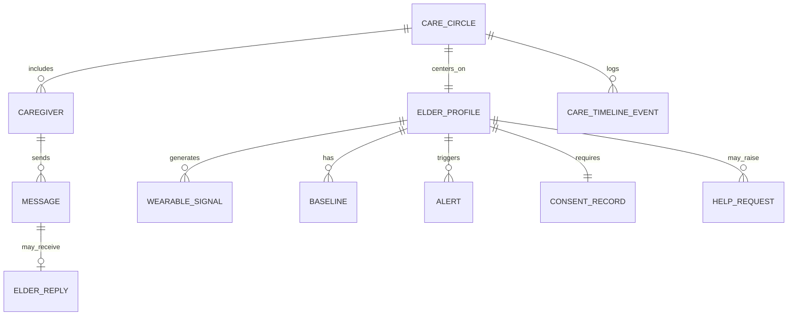

# IQcare — Architecture Essentials

Quick-reference companion to `Architecture.md`. If you only read one document at 2am during the hackathon, read this one.

| | |
|---|---|
| **Version** | 1.0 (Hackathon Prototype) |
| **Last updated** | September 22, 2026 |
| **Companion docs** | `prd.md`, `Architecture.md` |

---

## 1. Stack at a Glance

| Layer | Choice |
|---|---|
| Language | TypeScript |
| Framework | React 18 + Vite |
| App shell | PWA — installable on the iQOO phone home screen |
| Styling | Tailwind CSS |
| State | Zustand + `persist` (localStorage) |
| Charts | Recharts (optional dashboard trend view) |
| Icons | lucide-react |
| Camera / mic | `getUserMedia` + `MediaRecorder` — real device APIs, not mocks |
| Audio playback | HTML5 `<audio>` |
| STT | Web Speech API, scripted fallback for demo safety |
| TTS | Web Speech API, pre-recorded fallback for demo language(s) |
| AI | Cloud LLM call (AI credits) by default; on-device inference as stretch goal |
| Testing | Vitest, on pure-logic modules only |
| Hosting | Vercel / Netlify — **HTTPS required** for camera/mic access |
| *(Future)* Backend | Firebase or Supabase, only if cross-device sync becomes a stretch goal |

---

## 2. Data Models at a Glance



| Entity | Core fields | Why it exists |
|---|---|---|
| `ElderProfile` | name, preferredLanguage, deviceType, phoneNumber | Central subject; `deviceType` drives which UI/channel is used |
| `Caregiver` | name, role, notifyBy, careCircleIds | Can belong to more than one family circle |
| `ConsentRecord` | consentGivenBy, monitoredMetrics, visibleTo, revocable | **Gap-fill** — monitoring cannot start without this |
| `Alert` | deviationScore, explanationText, status, cooldownUntil | `explanationText` always AI-generated via the safety-guarded path |
| `Message` / `ElderReply` | type, mediaRef/audioRef, transcript, aiAssisted | Every transcript is explicitly flagged, never presented as verbatim without caveat |
| `HelpRequest` | notifiedCaregiverIds, status | **Gap-fill** — the "I'm NOT okay" path the source concept was missing |
| `CareTimelineEvent` | type, actorId, summary | The shared family record everyone sees |

Full field-level detail: `Architecture.md` §7.

---

## 3. Modules at a Glance

| Module | Does | Real-world future replacement |
|---|---|---|
| `SimulationEngine` | Generates seeded, reproducible wearable signals | Google Fit / Fitbit / HealthKit |
| `BaselineService` | Rolling mean/stddev per elder × metric × time-of-day | — (stays as-is) |
| `AnomalyDetector` | Deviation threshold + cooldown | — (stays as-is) |
| `AlertExplainer` / `SafetyGuard` | Turns deviation into safe, plain-language text — **the only place alert copy is generated** | — (stays as-is; this is the safety chokepoint, always keep it) |
| `CareCircleStore` | Single shared client state, "View As" switcher | — |
| `MessageService` | Voice/photo send, routes by device type | — |
| `IVRSimulator` | On-screen simulated call, keypad input | Twilio / Exotel |
| `TranscriptService` | STT + AI summarization of elder replies | Google/Azure Speech for better multilingual accuracy |
| `HelpRequestService` | All-caregiver emergency notify | + SMS/push gateway |
| `ConsentService` | Gates monitoring on recorded consent | — |
| `DemoModeController` | Scripted, judge-safe demo sequence | Hackathon-only, not a shipped feature |
| `PersistenceLayer` | localStorage today | Firebase/Supabase → real backend |

---

## 4. Boundaries

### 4.1 Simulated vs. Real (be honest about this to judges — it's a strength, not a weakness)

| Simulated for the prototype | Genuinely real for the prototype |
|---|---|
| Wearable device data | Camera capture (photo) |
| Telephone network / real calls | Microphone capture (voice) |
| Medical devices | The AI calls (alert explanation, reply summary) |
| | The PWA install + phone-native execution |

### 4.2 Client vs. Server
Everything runs **client-side, on the phone**, for the prototype. No backend, no database beyond `localStorage`. The two AI calls are the only network dependency, and both have an offline-safe fallback (`Architecture.md` §10.3). This boundary is a deliberate reliability choice, not a limitation to apologize for.

### 4.3 Safety boundary
All alert language passes through **one function** (`AlertExplainer`'s `SafetyGuard`). Nothing else in the codebase is allowed to generate text shown as an alert. This is what makes "never diagnoses" true in the code, not just true in this document.

### 4.4 Consent boundary
`AnomalyDetector` does not run for an elder without a `ConsentRecord` on file. In the prototype this can be a simple onboarding toggle — the point is that the data model makes the real, revocable version possible later, not that the prototype enforces it with production rigor.

### 4.5 Scope boundary — this system will not, in this build
- Diagnose, prescribe, or claim a medical emergency from one reading.
- Contact emergency services directly (it surfaces a number as reference only).
- Support more than one elder per care circle (v1 constraint, not a permanent one).
- Persist any real personal or health data.

### 4.6 Hackathon scoring boundary *(specific to iQOO Hackathon 2026)*
- The demo **must run on the iQOO phone**, installed, not just shown from a laptop browser.
- Camera and mic must be **real device APIs**, not file pickers standing in for them.
- At least one AI call must be **doing real interpretive work**, not a static template — this is separately and heavily scored.
- Meaningful build time should genuinely happen phone-only via Office Kit during Red Light — this is device-tracked, not self-reported.

Full reasoning for each of these: `prd.md` §4, `Architecture.md` §3 and §10.

---

## 5. One-Screen Cheat Sheet

```
Phone (installed PWA)
 ├─ Simulation → Baseline → Anomaly → AlertExplainer(AI, safety-guarded) ─┐
 │                                                                         ▼
 ├─ CareCircleStore (Zustand + localStorage) ←──────────────── single source of truth
 │        │
 │        ├─ Caregiver Dashboard UI  (compose, alerts, timeline)
 │        ├─ Grandma Mode UI          (3 + 1 big buttons)
 │        └─ IVR Simulator UI         (on-screen call, keypad)
 │
 ├─ ElderReply → TranscriptService(AI) → back into the Store
 ├─ HelpRequestService → notifies ALL caregivers
 └─ DemoModeController → scripted, judge-safe run-through

Network dependency: only the two AI calls. Everything else works offline.
```
