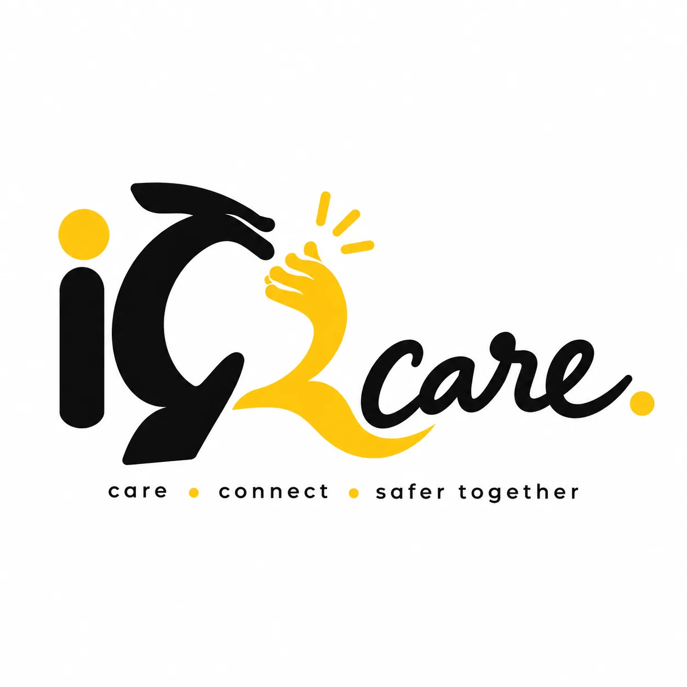

<p align="center">
  
</p>

<h1 align="center">iQcare — Signal to Care</h1>

<p align="center">
  A voice-first family-care bridge between an older adult and a distant caregiver.<br />
  <em>"Technology should adapt to the older person, not the older person to the technology."</em>
</p>

<p align="center">
  <a href="https://iqcare.vercel.app"><strong>Live Demo →</strong></a>
</p>

---

## What is iQcare?

iQcare is a hackathon prototype that demonstrates a **care bridge** connecting two very different users:

| Role | Experience |
|---|---|
| **Caregiver** (grandchild / parent) | A rich, detailed dashboard with health signals, alerts, voice messaging, image sharing, and an AI-powered signal explainer. |
| **Grandma** (older adult) | An extremely simple, high-contrast, large-button interface designed for minimal cognitive load — or a normal phone/IVR interaction. |

The core insight: the **caregiver** absorbs the complexity. The **grandparent** receives a frictionless, familiar experience.

---

## Key Features

### Bidirectional Voice Messaging
- Record voice messages from either role using the browser's `MediaRecorder` API.
- Real-time **Speech-to-Text** via `webkitSpeechRecognition` (Chrome/Edge).
- Audio is serialised to Base64 and persisted in `localStorage` for instant cross-role playback.
- Graceful fallback with simulated transcript when microphone permission is denied.

### Bidirectional Image Sharing
- Select, preview, and send photos from either Caregiver or Grandma mode.
- Images are compressed client-side via `Canvas API` (max 600px, JPEG 0.6 quality) to fit within browser storage limits.
- Shared images appear instantly on the other role's screen.

### Caregiver Dashboard
- **Offline-first Bridge** — compose messages even without internet; queue for SMS or sync later.
- **Signal Confidence** — a visual indicator of how closely Meera's activity matches her learned baseline.
- **Care Loop** — a 5-stage visual pipeline: Sense → Understand → Alert → Connect → Care.
- **Health Metrics** — heart rate, movement (steps), and rest quality cards with trend indicators.
- **Bridge Inbox** — a unified, scrollable message feed showing all voice and image exchanges.
- **Anomaly Alerts** — when simulated wearable data deviates from Meera's personal baseline.

### Grandma Mode
- **Senior-first design** — large touch targets (64–72px buttons), high contrast, minimal navigation.
- Receives and plays voice messages from the caregiver.
- Views shared photos.
- One-tap **"I'm feeling okay"** and **"Ask family for help"** actions.
- Can send voice messages and photos back to the caregiver.

### AI Signal Explainer
- Deterministic, safety-guarded text generation (`aiService.ts`).
- Produces warm, non-diagnostic language: *"Meera's movement is 28% lower than her usual afternoon pattern. This is not a diagnosis — just a gentle signal worth noticing."*
- Every output passes through a `guardSafety()` function that strips forbidden medical/diagnostic terms.
- Architected for a future server-side LLM proxy — no API keys are ever exposed client-side.

### Anomaly Simulation Engine
- `simulationEngine.ts` generates realistic wearable data using Box-Muller gaussian noise against Meera's 7-day learned baselines.
- Z-score based anomaly detection (threshold: 1.8σ).
- All simulated data is clearly labelled in the UI as *"Simulated wearable data • not a medical device"*.

---

## Tech Stack

| Layer | Technology |
|---|---|
| Framework | React 19 + TypeScript 5.6 |
| Build | Vite 7 |
| Styling | Tailwind CSS 4 + custom CSS (Grid/Flexbox) |
| UI Components | Radix UI primitives, Lucide icons |
| State | React `useState` + `localStorage` persistence |
| Voice | `MediaRecorder`, `webkitSpeechRecognition`, `SpeechSynthesis` |
| Deployment | Vercel (static frontend) |
| Package Manager | pnpm 10 |

---

## Project Structure

```
iqcare-app/
├── client/
│   ├── public/              # Static assets, PWA manifest, service worker
│   │   └── brand/           # Logo and brand assets
│   ├── src/
│   │   ├── pages/
│   │   │   └── Home.tsx     # Main application (Caregiver + Grandma modes)
│   │   ├── lib/
│   │   │   ├── aiService.ts          # AI signal explainer (deterministic)
│   │   │   └── simulationEngine.ts   # Wearable data simulation
│   │   ├── components/      # Radix UI component library
│   │   ├── index.css        # Global styles (Black/White/Yellow design system)
│   │   ├── App.tsx          # Router
│   │   └── main.tsx         # Entry point
│   └── index.html
├── vercel.json              # Deployment configuration
├── vite.config.ts           # Build configuration
├── tsconfig.json
└── package.json
```

---

## Getting Started

### Prerequisites

- [Node.js](https://nodejs.org/) v18+
- [pnpm](https://pnpm.io/) v10+

### Install & Run

```bash
# Clone the repository
git clone <repo-url>
cd iqcare-app

# Install dependencies
pnpm install

# Start development server
pnpm dev
```

The app will be available at `http://localhost:5173`.

### Build for Production

```bash
# Type-check
pnpm check

# Production build
pnpm build

# Preview production build locally
pnpm preview
```

---

## Demo Walkthrough

Follow these steps for a complete hackathon demo:

| Step | Action | Expected Result |
|:---:|---|---|
| 1 | Open the app — you land on the **Caregiver Dashboard**. | Dashboard shows greeting, health metrics, signal confidence, and care loop. |
| 2 | Click **"Send voice message"**. | Voice recorder modal opens; browser requests microphone permission. |
| 3 | Speak: *"Thinking of you, Grandma."* → Stop → **Send**. | Message appears in the Bridge Inbox with your transcript. |
| 4 | In the header, click **Grandma** to switch roles. | Grandma Mode opens with *"Hello, Meera."* |
| 5 | Observe the voice message from Sumanth. Press **PLAY MESSAGE**. | The actual recorded audio plays back through the browser. |
| 6 | In Grandma Mode, tap **Send Voice Message**. Record: *"I am feeling okay."* → Send. | Message is saved to shared state. |
| 7 | Switch back to **Caregiver**. | The Bridge Inbox now shows Meera's voice reply with a Play button. |
| 8 | Click **"Share a photo"** → select an image → **Send**. | Photo appears in inbox. |
| 9 | Switch to **Grandma**. | Meera sees the shared photo. |
| 10 | Grandma taps **Send Photo** → selects an image → sends. | Photo is stored and shared. |
| 11 | Switch to **Caregiver**. | Caregiver sees Meera's photo in the inbox. |
| 12 | Grandma taps **"I'm feeling okay"**. | Button confirms; caregiver dashboard clears alert. |
| 13 | Grandma taps **"Ask family for help"**. | Alert banner appears on the caregiver dashboard. |

> **Demo Reset:** Click the logout icon (↗) at the bottom of the sidebar to clear all state and start fresh.

---

## Design System

The application uses a strict **Black + White + Yellow** visual language:

| Token | Value | Usage |
|---|---|---|
| Primary Black | `#0B0B0B` | Sidebar, dark cards, primary text |
| White | `#FFFFFF` | Content backgrounds, cards |
| Background | `#F7F7F5` | Page background |
| Yellow (accent) | `#FFD600` | Active states, primary buttons, highlights |
| Soft Yellow | `#FFF4B8` | Alert banners, confirmation states |
| Muted Text | `#6B6B6B` | Secondary labels |
| Borders | `#E8E8E8` | Card borders, dividers |

Yellow is used **strategically** as an accent — never as a dominant background colour.

---

## Architecture Principles

1. **No backend required** — the entire prototype runs as a static frontend. All state is persisted in `localStorage`.
2. **No API keys exposed** — the AI service uses deterministic templates. The architecture supports a future server-side LLM proxy.
3. **Non-diagnostic language** — every AI-generated explanation passes through a safety guard that strips medical terminology.
4. **Offline-capable** — messages can be queued when offline and synced later. A service worker provides basic caching.
5. **Senior-first accessibility** — Grandma Mode prioritises large touch targets, high contrast, and minimal cognitive load.

---

## Deployment

The app is deployed on [Vercel](https://vercel.com) as a static site.

```bash
# Deploy via Vercel CLI
vercel --prod
```

Or connect your GitHub repository to Vercel for automatic deployments on push.

**Configuration** (`vercel.json`):
- Build command: `pnpm build`
- Output directory: `dist/public`
- SPA rewrites enabled
- Security headers configured (HSTS, nosniff, microphone/camera permissions)

---

## Browser Compatibility

| Feature | Chrome | Edge | Firefox | Safari |
|---|:---:|:---:|:---:|:---:|
| Voice Recording | ✅ | ✅ | ✅ | ✅ |
| Speech-to-Text | ✅ | ✅ | ❌ (fallback) | ❌ (fallback) |
| Text-to-Speech | ✅ | ✅ | ✅ | ✅ |
| Image Sharing | ✅ | ✅ | ✅ | ✅ |

When Speech-to-Text is unavailable, the app gracefully falls back to a simulated transcript.

---

## Safety & Privacy

- **No cloud data transmission** — all data stays in the browser's `localStorage`.
- **No API keys or secrets** in the frontend code.
- **Security headers** enforce HTTPS, frame protection, and content-type validation.
- **Camera/microphone permissions** are requested only when the user initiates a voice or photo action.
- All health signals are **simulated** and clearly labelled as non-medical.

---

## License

MIT

---

<p align="center">
  Built with ❤️ for the iQOO Hackathon<br />
  <strong>iQcare</strong> — because care shouldn't need a tutorial.
</p>
